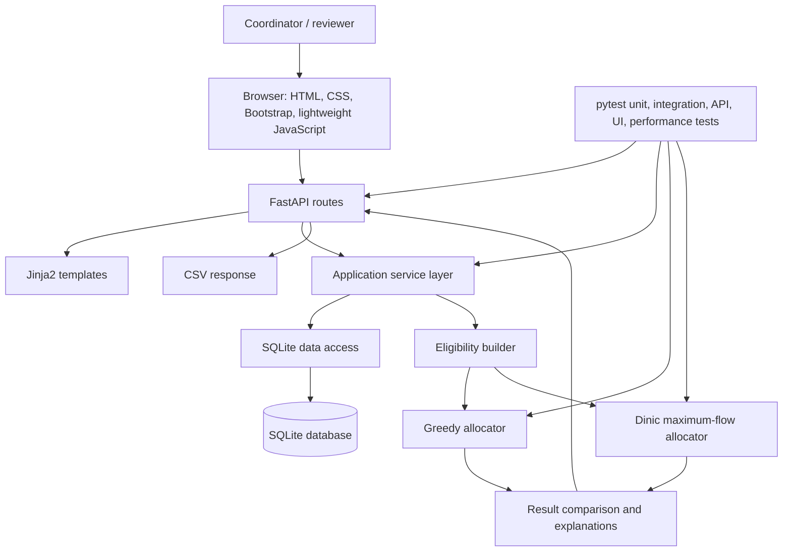

# Architecture

## Overview

The MVP uses a small, layered Python application. FastAPI handles HTTP requests, Jinja2 renders server-side HTML, SQLite stores the project data, and focused service and algorithm modules keep allocation logic independent of the web pages.



## Components

- **FastAPI routes:** validate request shape, invoke services, render pages, and return CSV responses. Routes should not contain allocation algorithms or hand-built SQL.
- **Jinja2 templates and static assets:** server-rendered HTML pages, shared navigation, forms, tables, status messages, CSS, and minimal JavaScript. No frontend framework is planned.
- **Service layer:** coordinates CRUD operations, obtains a consistent set of teams/guides/eligibility data, runs allocators, compares results, and creates explanation/report data.
- **Data access layer:** owns SQLite connections and parameterized queries. Use schema constraints where they reinforce application validation.
- **Eligibility builder:** turns the approved domain and explicit-rule policy into eligible team-guide edges consumed by both allocators.
- **Greedy allocator:** deterministic, easy-to-explain assignment procedure using the approved team and guide ordering. Its exact policy is a decision gate.
- **Dinic allocator:** constructs a flow network with source-to-team capacity 1, team-to-eligible-guide capacity 1, and guide-to-sink capacity equal to guide capacity. A unit of flow represents one assigned team.
- **Reporting:** normalizes allocator output into assignments, unassigned teams and reasons, guide loads, unused capacity, and summary counts. It compares assignment counts without implying preference optimization.
- **CSV response:** serializes the normalized result with the standard library and returns it as a download. Export content must be safely escaped and must not expose internal errors.
- **Tests:** pytest tests the algorithms and services directly, then exercises the HTTP interface and representative scale workloads.

## Proposed folder structure

```text
.
|-- app/
|   |-- __init__.py
|   |-- main.py
|   |-- routes/
|   |-- services/
|   |-- algorithms/
|   |   |-- greedy.py
|   |   |-- dinic.py
|   |-- data/
|   |   |-- database.py
|   |   |-- repositories.py
|   |-- templates/
|   |-- static/
|-- tests/
|   |-- unit/
|   |-- integration/
|   |-- api/
|   |-- ui/
|   |-- performance/
|-- docs/
|-- .env.example
|-- .gitignore
|-- README.md
|-- RULES.md
|-- TASKS.md
```

This is a proposal, not an instruction to create these directories in this documentation task. Keep the initial implementation smaller if a proposed subfolder would contain only one trivial module.

## Data and result flow

1. A coordinator manages teams and guides through FastAPI forms.
2. The data layer validates and stores records in SQLite.
3. The service loads one consistent input snapshot and applies the approved eligibility rules.
4. The greedy allocator and Dinic allocator receive the same teams, capacities, and eligible pairs.
5. Reporting validates and normalizes both outputs, computes loads and unused capacity, and produces unassigned reasons.
6. Routes render the comparison or serialize it as CSV.

The algorithm modules should be callable without starting FastAPI or opening a database. This allows small, focused correctness tests.

## Testing and performance architecture

Use pytest with small unit tests for graph and allocation logic, integration tests for persistence and services, HTTP tests for routes and exports, and browser/UI checks for key user journeys. Keep scale benchmarks separately selectable so slow or timing-sensitive checks do not make the ordinary test loop unreliable. Performance results must state team count, guide count, eligible-edge count/density, machine, and elapsed time.
